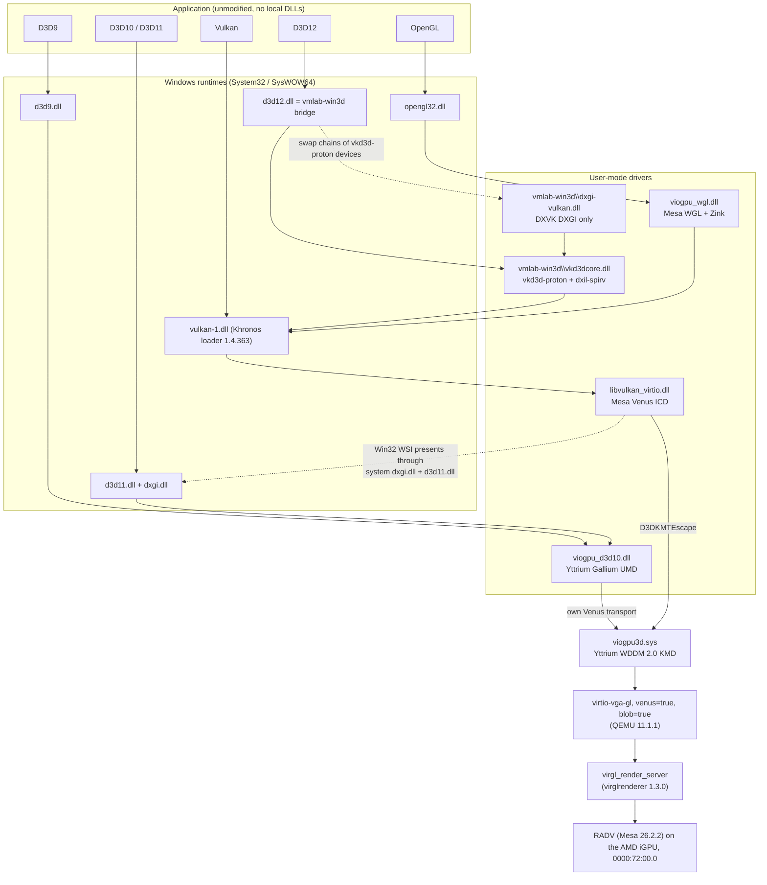

# Component stack

This page describes every layer between a Windows application in the guest
and the GPU in the host. For each component it lists the files installed in
the guest, how Windows finds them, the upstream source and pin, this
repository's patches, and the licence. The pin table comes from
`build/*/PINS`. The [patch inventory](#patches) comes from the series files.

## The path of a frame

Nothing in the guest talks to the GPU directly. Every API ends up as Vulkan
commands that the Venus protocol carries over virtio-gpu to the host. There,
virglrenderer replays them on the host's Vulkan driver. The diagram shows the
reference host, helios, where that driver is RADV on an AMD iGPU.
[Tested hosts](#tested-hosts) lists the other host GPUs.

Read the diagram with these points in mind:

- **D3D9, D3D10 and D3D11 do not go through Vulkan in the guest.** The
  Yttrium UMD translates shaders to SPIR-V and encodes Venus commands itself.
  It does not load `libvulkan_virtio.dll` or `vulkan-1.dll` (prior-art §1).
- **D3D12 is the only API that needs a system file replaced.** Windows has no
  supported way to register a third-party D3D12 implementation except a
  native D3D12 UMD, which no component here provides. The installer replaces
  `d3d12.dll` with a bridge that loads vkd3d-proton (see
  [Known limits](known-limits.md)).
- **Every Vulkan-based frame is presented through the D3D11 UMD.** Mesa's
  Win32 WSI creates a D3D11 device on the system `dxgi.dll` and `d3d11.dll`
  and copies each image into a composition swap chain. That is why the
  package never replaces `dxgi.dll` or `d3d11.dll`; when the prior art did,
  even vkcube hung (prior-art §3, §4.5).
- **The host side is not built here.** QEMU, virglrenderer and RADV are the
  host's Arch packages (`docs/host.md`). Decision D3 in `docs/plan.md` keeps
  them at the versions shown. The exception is NVIDIA hosts, which need a
  patched QEMU ([patches/host/](https://github.com/VMLabDev/vmlab-win3d/blob/229203dd8d82c261f4a7a676afb3259fc30ad9ff/patches/host/), [Host patches](#host-patches)).

The probes confirm which modules each API loads in the guest:
[docs/evidence/package/03-probes-summary.json](https://github.com/VMLabDev/vmlab-win3d/blob/229203dd8d82c261f4a7a676afb3259fc30ad9ff/docs/evidence/package/03-probes-summary.json), `graphics_modules`.

## Layers

Paths are for a default Windows directory. "x64" files go to
`C:\Windows\System32`, "x86" files to `C:\Windows\SysWOW64`. The class key is
the display adapter's
`HKLM\SYSTEM\CurrentControlSet\Control\Class\{4d36e968-e325-11ce-bfc1-08002be10318}\<nnnn>`.

### Windows runtimes

| | |
| --- | --- |
| Guest files | `d3d9.dll`, `d3d11.dll`, `dxgi.dll`, `opengl32.dll`, `D3D12Core.dll` |
| Found by | They ship with Windows. The package leaves all of them in place. |
| Upstream | Microsoft |

The D3D9 and D3D11 runtimes read `UserModeDriverName[Wow]` from the class key
and load the UMD named there. `opengl32.dll` reads `OpenGLDriverName[Wow]`
and loads the WGL ICD. The package changes only `d3d12.dll`, described below.

### Vulkan loader

| | |
| --- | --- |
| Guest files | x64 and x86: `vulkan-1.dll`, `vulkaninfo.exe` |
| Found by | Applications import `vulkan-1.dll` from System32/SysWOW64. The loader finds ICDs through `HKLM\SOFTWARE\Khronos\Vulkan\Drivers` (and `WOW6432Node`). |
| Installed by | `installer/vmlab-win3d.ps1`, only when the existing `vulkan-1.dll` is missing or has an older file version. The template has 1.3.300. |
| Upstream | [KhronosGroup/Vulkan-Loader](https://github.com/KhronosGroup/Vulkan-Loader) and [Vulkan-Tools](https://github.com/KhronosGroup/Vulkan-Tools), tag `vulkan-sdk-1.4.363.0` |
| Build | [`build/vulkan-sdk/`](../build/vulkan-sdk/README.md) |
| Patches | [Vulkan-Tools series](../patches/vulkan-tools/series), which stops the llvm-mingw `vulkaninfo.exe` crashing on a null `user32_handles` |
| Licence | Apache-2.0 |

### D3D12: the bridge, vkd3d-proton and DXVK's DXGI

| | |
| --- | --- |
| Guest files | x64 and x86: `d3d12.dll` (the bridge), `vmlab-win3d\vkd3dcore.dll`, `vmlab-win3d\dxgi-vulkan.dll`, `vmlab-win3d\d3d12-native.dll`, which is the machine's own `d3d12.dll` copied at install time, and `vmlab-win3d\native\d3d12.dll`, the same file a second time for Chromium GPU processes ([chromium.md](chromium.md)) |
| Found by | Applications load `d3d12.dll` from System32/SysWOW64 as usual. The bridge finds `vmlab-win3d\` next to its own file, with no registry or environment lookup. |
| Installed by | The installer: takes ownership of `d3d12.dll`, replaces it, and restores the TrustedInstaller owner and ACL. The `vmlab-win3d-repair` startup task puts the bridge back after Windows servicing and renews both native copies. |
| Upstream | [vkd3d-proton](https://github.com/HansKristian-Work/vkd3d-proton) v3.0.1, [dxil-spirv](https://github.com/HansKristian-Work/dxil-spirv) at `8434b063` (newer than vkd3d-proton's gitlink), [DXVK](https://github.com/doitsujin/dxvk) v3.1.1 built with only DXGI |
| Build | [`build/d3d12/`](../build/d3d12/README.md) |
| Patches | [vkd3d-proton](../patches/vkd3d-proton/series), [DXVK](../patches/dxvk/series) and [dxil-spirv](../patches/dxil-spirv/series) series. The bridge patch turns vkd3d-proton's `d3d12.dll` into the system-wide bridge. |
| Licence | vkd3d-proton LGPL-2.1-or-later; dxil-spirv MIT; DXVK zlib |

The bridge implements the D3D12 entry points with vkd3d-proton and forwards
every other export to `d3d12-native.dll`. It hooks the four
`CreateSwapChain*` methods of the native DXGI factory, so swap chains on
vkd3d-proton queues go to DXVK's DXGI, and everything else stays native.
`build/d3d12/README.md` explains the export table and the hooks.

### D3D9, D3D10 and D3D11: the Yttrium UMD

| | |
| --- | --- |
| Guest files | x64 and x86: `viogpu_d3d10.dll` |
| Found by | Class key `UserModeDriverName` = `C:\Windows\System32\viogpu_d3d10.dll` three times (D3D9, D3D10, D3D11), `UserModeDriverNameWow` = the SysWOW64 path three times, `InstalledDisplayDrivers` = `viogpu_d3d10` three times. There is no D3D12 entry. |
| Installed by | The INF (`VioGpu3D_Files.Usermode`, `VioGpu3D_Files.Wow64`, `VioGpu3D_DeviceSettings`) |
| Upstream | [arehnman/virtio-win-mesa](https://github.com/arehnman/virtio-win-mesa), branch `yttrium-experimental`, commit `76c095bb`, the November 2026 release (Mesa 26.1.0) |
| Build | [`build/mesa/`](../build/mesa/README.md) |
| Patches | [Mesa series](../patches/mesa/series), shared with the two Mesa components below. [`build/mesa/README.md`](../build/mesa/README.md) says which patch changes which DLL, and which patches the November rebase dropped. |
| Licence | Mesa MIT; the Yttrium winsys (`src/gallium/winsys/yttrium/gdi/`) MPL-2.0 |

`viogpu_d3d10.dll` is Mesa's `d3d10umd` front end (D3D10/11 DDI, plus a
D3D9 DDI) on the Yttrium Gallium driver. It talks to the KMD through its own
embedded Venus transport.

### OpenGL: Mesa WGL with Zink

| | |
| --- | --- |
| Guest files | x64 and x86: `viogpu_wgl.dll` |
| Found by | Class key `OpenGLDriverName` and `OpenGLDriverNameWow` = `viogpu_wgl.dll` in System32 and SysWOW64, `OpenGLFlags[Wow]` = 3, `OpenGLVersion[Wow]` = 4096 |
| Installed by | The INF. The package does not replace `opengl32.dll`, unlike Yttrium's release INF. |
| Upstream | Same Mesa tree as above |
| Patches | Mesa's case-insensitive executable matching, loader lock and WGL unbind patches |
| Licence | MIT |

Zink turns OpenGL into Vulkan and runs on the Venus ICD through
`vulkan-1.dll`. The probe reports the renderer as
`zink Vulkan 1.4 (Virtio-GPU Venus (… RADV RAPHAEL_MENDOCINO))`.

### Vulkan: the Mesa Venus ICD

| | |
| --- | --- |
| Guest files | x64: `libvulkan_virtio.dll`, `virtio_icd.x86_64.json`; x86: `libvulkan_virtio.dll`, `virtio_icd.x86.json` |
| Found by | `HKLM\SOFTWARE\Khronos\Vulkan\Drivers` value `C:\Windows\System32\virtio_icd.x86_64.json` = 0, and `HKLM\SOFTWARE\WOW6432Node\Khronos\Vulkan\Drivers` value `C:\Windows\SysWOW64\virtio_icd.x86.json` = 0. Each manifest names `.\libvulkan_virtio.dll`, relative to itself, with `api_version` 1.4.348. |
| Installed by | The INF (`VioGpu3D_Files.Vulkan`, `VioGpu3D_Files.VulkanWow64`) |
| Upstream | Same Mesa tree, `src/virtio/vulkan` |
| Patches | Mesa's WDK build and Win32 NT-handle memory patches |
| Licence | MIT; `vn_renderer_d3dkmt.c` MPL-2.0 |

The ICD reports itself as `Virtio-GPU Venus (<host GPU name>)`. Its Windows
renderer, `vn_renderer_d3dkmt.c`, submits Venus commands to the KMD with
`D3DKMTEscape`. The ICD therefore works only with the Yttrium KMD.

### Kernel: the Yttrium viogpu3d KMD

| | |
| --- | --- |
| Guest files | `viogpu3d.sys`, `vgpusrv.exe`, `viogpuap.exe` in the driver store (`C:\Windows\System32\DriverStore\FileRepository\viogpu3d.inf_amd64_<hash>\`, INF DIRID 13); the INF as `C:\Windows\INF\oem<NN>.inf` |
| Found by | PnP matches the INF's hardware ID `PCI\VEN_1AF4&DEV_1050&SUBSYS_11001AF4&REV_01`. The INF adds the kernel service `VioGpu3D` and the user service `vgpusrv` ("Yttrium VirtIO Resolution Service"), which starts `viogpuap.exe` in each user session. |
| Installed by | The installer runs `pnputil /add-driver viogpu3d.inf /install`. The package is test-signed ([decision 0001](decisions/0001-signing.md)). |
| Upstream | [arehnman/yttrium-virtio-gpu](https://github.com/arehnman/yttrium-virtio-gpu), tag `yttrium-experimental-2026-11-02` (`e9917ae2`), a fork of virtio-win/kvm-guest-drivers-windows |
| Build | [`build/kmd/`](../build/kmd/README.md), clang-cl and lld-link against the WDK NuGet packages |
| Patches | [KMD series](../patches/kmd/series) |
| Licence | BSD-3-Clause; Yttrium's changes to `viogpu3d` are also MPL-2.0 where marked |

The device appears as "Yttrium VirtIO GPU 3D controller" (upstream renamed
it from "Hardsoft VirtIO GPU 3D controller" in the November release), driver
version 100.6.101.58113. It is a WDDM 2.0 display miniport with Venus and blob
resource support, a hardware pointer ([pointer.md](pointer.md)), a 60 Hz
VidPN timer (on vmlab-hv the host's frame clock, [vblank.md](vblank.md)), and on vmlab-hv a flip that the host orders ([flip.md](flip.md)). It needs the
`VIRTIO_GPU_F_VIRGL` feature, so it fails to start on a plain `virtio-vga`.

### Device: virtio-gpu Venus in vmlab-hv

vmlab-hv's in-tree virtio-gpu implements the device; its renderer uses
rutabaga and the shared virglrenderer build. A lab selects it with
`hypervisor = "vmlab"` and `gpu { mode = "vulkan" host_gpu = "AMD1" }`.

### Host: virglrenderer and the Vulkan driver

The vmlab-hv bundle ships matching patched copies of libvirglrenderer and
virgl_render_server. Its launcher selects that server, which forks render
workers to replay Venus commands on the host Vulkan driver.
vmlab applies its GPU PCI filter and ICD selection to the hypervisor's
environment. The host still supplies RADV, ANV or the NVIDIA Vulkan driver.

### Tested hosts

The package was run on four host GPUs. AMD (RADV) is the reference: the
acceptance runs in `docs/acceptance.md` used it. Intel (ANV) passes with
`patches/mesa/0021`. NVIDIA works only partly. The full matrix, with the
evidence for each row, is in
[Known limits: host GPU support](known-limits.md#host-gpu-support).

### Host patches

The repository-root patches/virglrenderer/ directory carries 0001
image-allocation logging, 0002 NVIDIA queue-sync fence timing and 0003
memory-import export-info removal. The root build/hv.py and e2e image
apply all three; hypervisor tests use that build. diagnostic/0040 remains
unapplied. The obsolete feedback-loop workaround is removed because the
guest UMD asks the host before it adds feedback-loop usage (Mesa patch 0020
until the November rebase, upstream's own check since).

The vmlab-hv release bundle ships the patched library and render server.
win3d no longer builds or ships a QEMU fork or a separate host asset.

### Build-only inputs

These produce the binaries but are not installed in the guest:

| Input | Used for | Licence |
| --- | --- | --- |
| llvm-mingw 20261006 (LLVM 23.1.3, ucrt) | Every user-mode build, and clang-cl/lld-link for the KMD. libc++, libunwind and winpthread are linked statically into the DLLs. | Apache-2.0 WITH LLVM-exception; mingw-w64 runtime under its own permissive licences |
| Windows SDK and WDK NuGet packages | Headers for Mesa (10.0.26100.1); headers and kernel libraries for the KMD (10.0.26100.6584) | Microsoft software licence terms |
| DirectX-Headers v1.619.1 | Mesa's D3D headers | MIT |
| LINBIT generate-cat-file, osslsigncode | The driver catalog and Authenticode signatures (`build/signing/`) | GPL-2.0, GPL-3.0 |

## Pins

Generated from every `build/<component>/PINS` and [patches/host/PINS](https://github.com/VMLabDev/vmlab-win3d/blob/229203dd8d82c261f4a7a676afb3259fc30ad9ff/patches/host/PINS) by `scripts/pins-table.py
--write`; `scripts/pins-table.py --check` fails when this table is stale. Git
sources are pinned by commit, so they have no download hash. Each `PINS` file
also records the `SOURCE_DATE_EPOCH` its build uses, and the KMD and signing
Dockerfiles pin their Debian packages by version.

<!-- BEGIN generated pins table: scripts/pins-table.py --write -->
| Build | Input | Version or tag | Commit or digest | sha256 of the download | Source |
| --- | --- | --- | --- | --- | --- |
| [`d3d12`](../build/d3d12/PINS) | vkd3d-proton | `v3.0.1` | `3b10bd7a7ec6a7347e616cf8bea59333afec2255` | — | https://github.com/HansKristian-Work/vkd3d-proton |
| [`d3d12`](../build/d3d12/PINS) | dxil-spirv | `master` | `8434b0639fb2a48ce13aac08a420ecce5d23df0e` | — | https://github.com/HansKristian-Work/dxil-spirv |
| [`d3d12`](../build/d3d12/PINS) | dxvk | `v3.1.1` | `b1a1c99ab52b687cf950d62c88bc2fa316b41663` | — | https://github.com/doitsujin/dxvk |
| [`d3d12-samples`](../build/d3d12-samples/PINS) | samples | `master` | `e5975f9b0744fc5096dd593ed72bf8f5c004164f` | — | https://github.com/microsoft/DirectX-Graphics-Samples |
| [`d3d12-samples`](../build/d3d12-samples/PINS) | xwin | `0.10.0` | — | `d870eb4b2f390878af6da1ccd3cf321d22fcb72720984853b4be732ae597fc88` | https://github.com/Jake-Shadle/xwin/releases/download/0.10.0/xwin-0.10.0-x86_64-unknown-linux-musl.tar.gz |
| [`d3d12-samples`](../build/d3d12-samples/PINS) | vsman | `17.14.37806.7` | — | `99dda859c4ae3c446eb25620d1a6237bb135d95d14d55cd1d30a15340bb39d80` | https://download.visualstudio.microsoft.com/download/pr/c95450be-0a45-4779-b142-33f567ccfd6e/a871a5ff41acebbe5037455fd6f51fcd4907b47d8f3c9860871ea0b222a2fd45/VisualStudio.vsman |
| [`d3d12-samples`](../build/d3d12-samples/PINS) | crt-version | `14.44.17.14` | — | — | — |
| [`d3d12-samples`](../build/d3d12-samples/PINS) | sdk-version | `10.0.26100` | — | — | — |
| [`d3d12-samples`](../build/d3d12-samples/PINS) | winsysroot | — | — | `6fa919063f99d4a9631b1cd4af63bae2fec84d53732d0288d0b89b4523bb493f` | — |
| [`d3d12-samples`](../build/d3d12-samples/PINS) | nuget-d3d12 | `1.618.3` | — | `799981b3569eae3a08468891fd4a0b027907b262a75a5cc3f48d621ee68a21db` | https://api.nuget.org/v3-flatcontainer/microsoft.direct3d.d3d12/1.618.3/microsoft.direct3d.d3d12.1.618.3.nupkg |
| [`d3d12-samples`](../build/d3d12-samples/PINS) | nuget-pix | `1.0.240308001` | — | `726acc93d6968e2146261a1e415521747d50ad69894c2b42b5d0d4c29fd66ec4` | https://api.nuget.org/v3-flatcontainer/winpixeventruntime/1.0.240308001/winpixeventruntime.1.0.240308001.nupkg |
| [`d3d12-samples`](../build/d3d12-samples/PINS) | dxc | `v1.8.2505.1` | — | `f2213da1fc99dc8778c8823078e16ba97c7f80f86a1d4520ab1adf4b462bc48c` | https://github.com/microsoft/DirectXShaderCompiler/releases/download/v1.8.2505.1/linux_dxc_2025_07_14.x86_64.tar.gz |
| [`kmd`](../build/kmd/PINS) | yttrium-virtio-gpu | `yttrium-experimental-2026-11-02` | `e9917ae25b2597306d483e1063dba08658139bc9` | — | https://github.com/arehnman/yttrium-virtio-gpu |
| [`kmd`](../build/kmd/PINS) | llvm-mingw | `20261006` | — | `5f9c6ed95b2d4bdb2869a488c5fd5857fbdabcf288a0aa3eb1da43f6a08d8ab4` | https://github.com/mstorsjo/llvm-mingw/releases/download/20261006/llvm-mingw-20261006-ucrt-ubuntu-22.04-x86_64.tar.xz |
| [`kmd`](../build/kmd/PINS) | wdk-x64 | `10.0.26100.6584` | — | `c393d03dfb640b5c92f546b32f6770ef68cd3aaf691956e7d66d8e2c28a1b55e` | https://api.nuget.org/v3-flatcontainer/microsoft.windows.wdk.x64/10.0.26100.6584/microsoft.windows.wdk.x64.10.0.26100.6584.nupkg |
| [`kmd`](../build/kmd/PINS) | sdk-cpp | `10.0.26100.6584` | — | `5d31b38205bdd9ac761b4cb39fbbc6b7209b01c11194324afc674d7d119483a0` | https://api.nuget.org/v3-flatcontainer/microsoft.windows.sdk.cpp/10.0.26100.6584/microsoft.windows.sdk.cpp.10.0.26100.6584.nupkg |
| [`kmd`](../build/kmd/PINS) | debian | `debian:12` | `sha256:2c037a04925515fdd6ea85ea14a682d0e79931f5e9f5d07b6dbfc6ba12f9e858` | — | docker.io/library/debian |
| [`mesa`](../build/mesa/PINS) | mesa | — | `76c095bbbd875fda21e55c69d9e1eed56980d956` | `3b7a26e16b513fde18e02adf2478f9fc02d03793c64a61516f3935226cee3902` | https://github.com/arehnman/virtio-win-mesa/archive/76c095bbbd875fda21e55c69d9e1eed56980d956.tar.gz |
| [`mesa`](../build/mesa/PINS) | windows-sdk-cpp | `10.0.26100.1` | — | `b4730a467a8f29145fc0136b2b3f626767e985f6aa6e32f1352953c38d6ff5d2` | https://api.nuget.org/v3-flatcontainer/microsoft.windows.sdk.cpp/10.0.26100.1/microsoft.windows.sdk.cpp.10.0.26100.1.nupkg |
| [`mesa`](../build/mesa/PINS) | windows-wdk-x64 | `10.0.26100.1` | — | `247b2919ae451f65ba5f1cd51c7c39730fb0fc383d607f3e8ab317fddc8a8239` | https://api.nuget.org/v3-flatcontainer/microsoft.windows.wdk.x64/10.0.26100.1/microsoft.windows.wdk.x64.10.0.26100.1.nupkg |
| [`mesa`](../build/mesa/PINS) | DirectX-Headers | `v1.619.1` | `9e393d6d8a3b30dcc6f2806ef604ec16a27b0d7e` | `6193774904c940eebb9b0c51b816b93dd776cfeb25a951f0f4a58f22387e5008` | https://github.com/microsoft/DirectX-Headers/archive/refs/tags/v1.619.1.tar.gz |
| [`probes`](../build/probes/PINS) | vulkan-headers | `vulkan-sdk-1.4.363.0` | `6802bb4733b63ed5efd3adb308a6c885ef180ea1` | `4a078be12bef21cfebc09d878b77a63cff9d68f899254a0b00d0e37ef73e7f7e` | https://github.com/KhronosGroup/Vulkan-Headers/archive/refs/tags/vulkan-sdk-1.4.363.0.tar.gz |
| [`signing`](../build/signing/PINS) | generate-cat-file | — | `65ebf4de79a42b0a1104fbef37b1c207ff13e1e9` | — | https://github.com/LINBIT/generate-cat-file |
| [`signing`](../build/signing/PINS) | debian | `debian:12` | `sha256:2c037a04925515fdd6ea85ea14a682d0e79931f5e9f5d07b6dbfc6ba12f9e858` | — | docker.io/library/debian |
| [`toolchain`](../build/toolchain/PINS) | base-image | `ubuntu:24.04` | `sha256:ac3a3d13e90c660a1cb3e89ec695533399f7378dc1ae5fbdc28eb5781d561594` | — | docker.io/library/ubuntu |
| [`toolchain`](../build/toolchain/PINS) | apt-snapshot | `20261010T000000Z` | — | — | https://snapshot.ubuntu.com/ubuntu/20261010T000000Z/ |
| [`toolchain`](../build/toolchain/PINS) | llvm-mingw | `20261006` | — | `5f9c6ed95b2d4bdb2869a488c5fd5857fbdabcf288a0aa3eb1da43f6a08d8ab4` | https://github.com/mstorsjo/llvm-mingw/releases/download/20261006/llvm-mingw-20261006-ucrt-ubuntu-22.04-x86_64.tar.xz |
| [`toolchain`](../build/toolchain/PINS) | meson | `1.9.1` | — | `f824ab770c041a202f532f69e114c971918ed2daff7ea56583d80642564598d0` | https://pypi.org/project/meson/1.9.1/ |
| [`toolchain`](../build/toolchain/PINS) | mako | `1.3.10` | — | `baef24a52fc4fc514a0887ac600f9f1cff3d82c61d4d700a1fa84d597b88db59` | https://pypi.org/project/Mako/1.3.10/ |
| [`toolchain`](../build/toolchain/PINS) | markupsafe | `3.0.3` | — | `d6dd0be5b5b189d31db7cda48b91d7e0a9795f31430b7f271219ab30f1d3ac9d` | https://pypi.org/project/MarkupSafe/3.0.3/ |
| [`toolchain`](../build/toolchain/PINS) | packaging | `25.0` | — | `29572ef2b1f17581046b3a2227d5c611fb25ec70ca1ba8554b24b0e69331a484` | https://pypi.org/project/packaging/25.0/ |
| [`toolchain`](../build/toolchain/PINS) | pyyaml | `6.0.3` | — | `ba1cc08a7ccde2d2ec775841541641e4548226580ab850948cbfda66a1befcdc` | https://pypi.org/project/PyYAML/6.0.3/ |
| [`toolchain`](../build/toolchain/PINS) | bison (apt) | `2:3.8.2+dfsg-1ubuntu0.24.04.1` | — | — | — |
| [`toolchain`](../build/toolchain/PINS) | cmake (apt) | `3.28.3-1build7` | — | — | — |
| [`toolchain`](../build/toolchain/PINS) | flex (apt) | `2.6.4-8.2build1` | — | — | — |
| [`toolchain`](../build/toolchain/PINS) | glslang-tools (apt) | `15.1.0-2~ubuntu0.24.04.2` | — | — | — |
| [`toolchain`](../build/toolchain/PINS) | ninja-build (apt) | `1.11.1-2` | — | — | — |
| [`toolchain`](../build/toolchain/PINS) | python3 (apt) | `3.12.3-0ubuntu2.1` | — | — | — |
| [`vulkan-sdk`](../build/vulkan-sdk/PINS) | Vulkan-Headers | `vulkan-sdk-1.4.363.0` | `6802bb4733b63ed5efd3adb308a6c885ef180ea1` | `4a078be12bef21cfebc09d878b77a63cff9d68f899254a0b00d0e37ef73e7f7e` | https://github.com/KhronosGroup/Vulkan-Headers/archive/refs/tags/vulkan-sdk-1.4.363.0.tar.gz |
| [`vulkan-sdk`](../build/vulkan-sdk/PINS) | Vulkan-Loader | `vulkan-sdk-1.4.363.0` | `fa218055ff4948b159f31d43f800c808a13d51df` | `941eff558fc74f248745fb7df367640cf89a8457f216dae498a74ae14b6ba6f7` | https://github.com/KhronosGroup/Vulkan-Loader/archive/refs/tags/vulkan-sdk-1.4.363.0.tar.gz |
| [`vulkan-sdk`](../build/vulkan-sdk/PINS) | Vulkan-Tools | `vulkan-sdk-1.4.363.0` | `6fe2055cf2fa921d52a4c6a31528cfc279a6977f` | `6cbeb83294434e636a0c78760f1a6dfe3e50c1bab0cffa154603ce73e70508f1` | https://github.com/KhronosGroup/Vulkan-Tools/archive/refs/tags/vulkan-sdk-1.4.363.0.tar.gz |
<!-- END generated pins table -->

## Patches

Each guest component applies the patches in its `patches/<component>/series`
file in order. Run `scripts/pins-table.py` to print the current patch inventory
with links to the documentation for each patch.

Give a new patch a unique subject or card-based filename ending in `.patch`.
Append that filename on its own line to the component's `series` file. Git's
union merge driver keeps both additions when cards append independently.
If a patch depends on another card's patch, merge the prerequisite first.
Run `just ci::win3d-check` to verify each file is listed exactly once.
